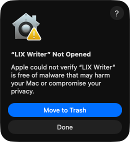
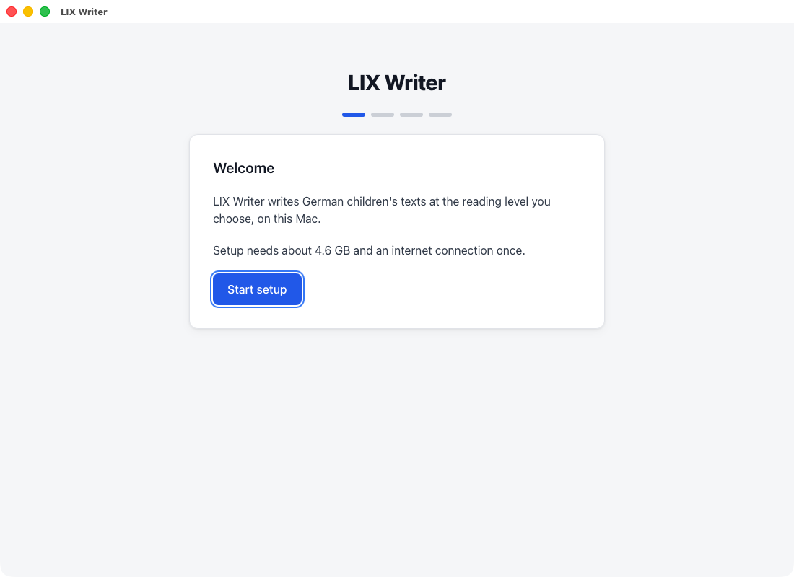
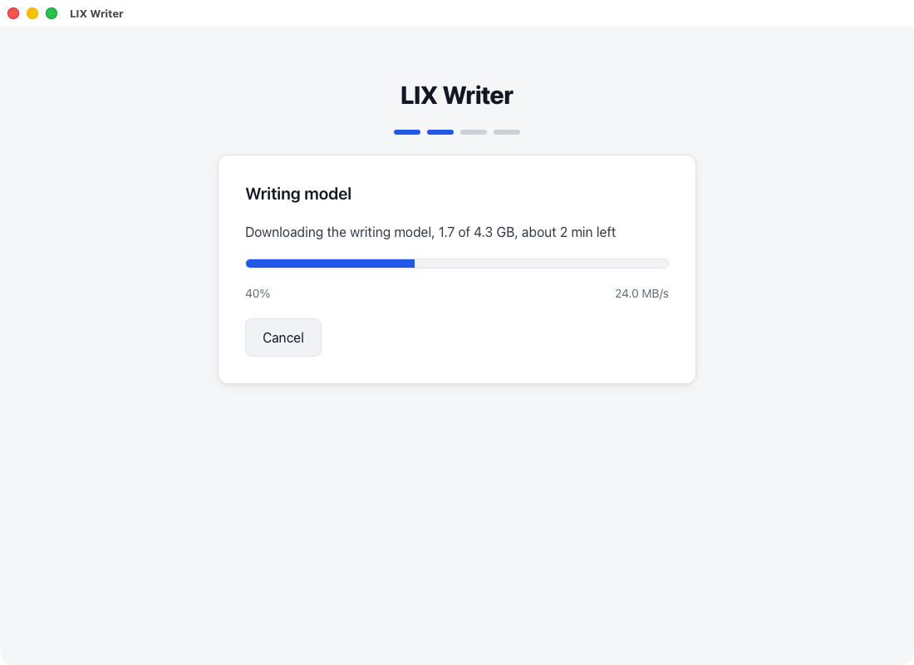
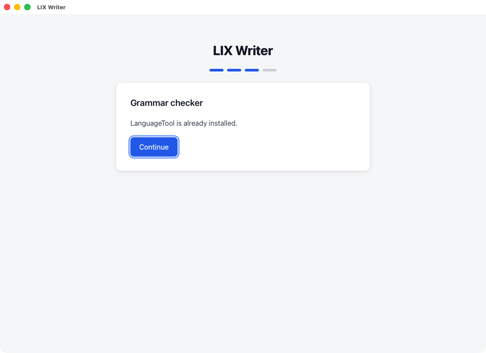
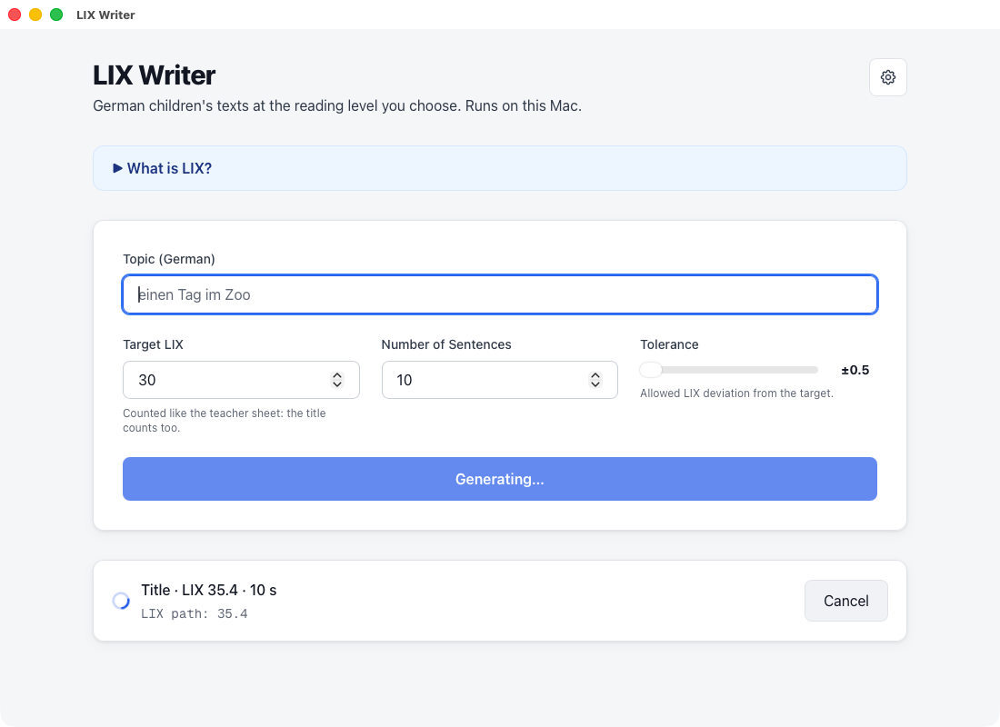
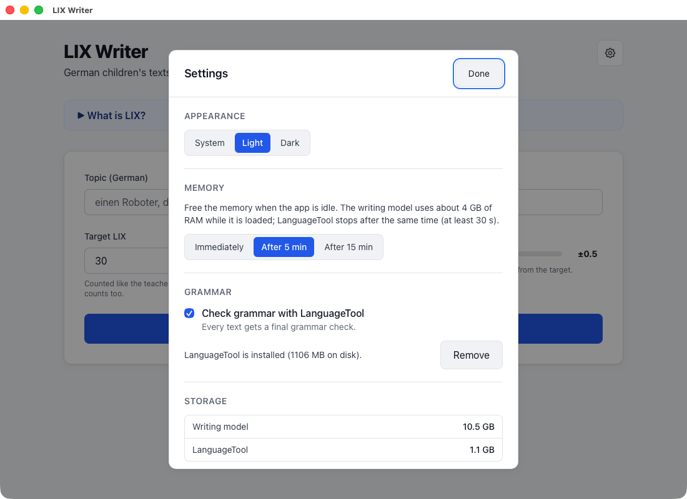

# LIX Writer: Handbuch

LIX Writer schreibt kurze deutsche Lesetexte für Kinder mit einem genauen LIX-Wert. Du wählst ein Thema, den LIX und die Anzahl Sätze. Die App schreibt eine Geschichte und passt sie so lange an, bis der LIX stimmt. Danach druckst du den Text als Lesetrainings-Blatt.

Alles läuft auf deinem Mac. Nach der Einrichtung braucht die App kein Internet mehr.

## 1. Was du brauchst

- Einen Mac mit Apple-Chip (M1 oder neuer) und macOS 14 (Sonoma) oder neuer.
- Etwa 5 GB freien Speicher (6 GB mit Grammatikprüfung).
- Einmal Internet für die Einrichtung.

## 2. Installieren

1. Lade auf der [Download-Seite](https://github.com/rotwurstesser/lix-tool/releases/latest) die Datei `LIX.Writer_0.1.0_aarch64.dmg` herunter.
2. Doppelklicke die Datei. Ein Fenster geht auf.
3. Ziehe **LIX Writer** in den Ordner **Programme** (Applications).
4. Öffne **LIX Writer** im Ordner Programme.

Beim ersten Öffnen meldet macOS, dass es die App nicht prüfen kann:

Das ist normal. Die App kommt nicht aus dem App Store und ist nicht von Apple signiert. So öffnest du sie trotzdem:

1. Klicke auf **Fertig** (Done).
2. Öffne **Systemeinstellungen → Datenschutz & Sicherheit**.
3. Scrolle nach unten. Neben der Meldung zu «LIX Writer» klickst du auf **Trotzdem öffnen** und bestätigst mit deinem Passwort.

Das machst du nur einmal.

## 3. Einrichtung beim ersten Start

1. **Schreibmodell:** Die App lädt ihr Schreibmodell herunter (4,3 GB). Das dauert einige Minuten. Du kannst abbrechen; der Download geht später dort weiter, wo er stand.

   

2. **Grammatikprüfung (freiwillig, empfohlen):** LanguageTool findet die meisten Grammatikfehler, die das Modell noch macht. Download etwa 300 MB, auf dem Mac etwa 560 MB. Du kannst sie später in den Einstellungen hinzufügen oder entfernen.

   

Danach ist die App bereit, auch ohne Internet.

## 4. Einen Text schreiben

1. **Thema:** zum Beispiel «ein Hund, der beim Bäcker wartet».
2. **Ziel-LIX:** der gewünschte Schwierigkeitsgrad. Unter 30 ist sehr leicht, 30 bis 40 leicht, 40 bis 50 mittel.
3. **Anzahl Sätze:** wie lang der Text wird.
4. Klicke auf **Generate text**.

Während die App schreibt, siehst du, was sie gerade macht. Ein Text dauert auf einem schnellen Mac etwa 15 Sekunden, auf kleineren Macs länger.

Danach siehst du den Text, den echten LIX und die Statistik. Trifft die App den Ziel-LIX nicht genau, zeigt sie den nächsten Text und seinen echten LIX. Mit **Try again** schreibt sie einen neuen.

Findet die Grammatikprüfung noch etwas, ist das Wort gewellt unterstrichen und unter dem Text aufgelistet. Lies diese Stellen kurz durch.

**So zählt die App:** Wie auf deinem Blatt zählt der Titel mit, als Wörter und als ein Satz. Lange Wörter haben mehr als 6 Buchstaben. Die Zielzeit rechnet mit 100 Wörtern pro Minute. Die App schreibt Schweizer Rechtschreibung (ss statt ß).

## 5. Lesetrainings-Blatt drucken

1. Ändere bei Bedarf den **Titel auf dem Blatt**. LIX, Wörter und Zielzeit rechnen sich neu.
2. Wähle, wo die Kästchen hinkommen:
   - **Boxes at the bottom:** alles auf einer Seite.
   - **Boxes on the back (two-sided):** Text vorne, Kästchen und Fusszeile hinten. Beidseitig drucken.
3. Klicke auf **Print sheet…**. Es öffnet sich der normale Druckdialog. Drucke das Blatt oder wähle unten links **Als PDF sichern**. Der Name ist schon ausgefüllt, zum Beispiel `Lesetraining_LIX26_Kater_Moritz.pdf`.

Damit ein Text auf eine Seite passt, verkleinert die App den Zeilenabstand in Schritten von 1,5 bis 1,15. Reicht das nicht, kommen die Kästchen von selbst auf die Rückseite. Die App sagt dir das unter der Auswahl.

Ist die Schrift «Deutschschweizer Basisschrift» auf deinem Mac installiert, verwendet das Blatt sie. Sonst nimmt es eine gut lesbare Ersatzschrift.

## 6. Einstellungen

Das Zahnrad oben rechts öffnet die Einstellungen.

- **Appearance (Darstellung):** System, Hell oder Dunkel.
- **Memory (Arbeitsspeicher):** Das Schreibmodell braucht etwa 4 GB Arbeitsspeicher, solange es geladen ist. Die App gibt ihn frei, wenn sie nichts tut: sofort, nach 5 Minuten (Standard) oder nach 15 Minuten. Beim Beenden der App wird alles freigegeben.
- **Grammar (Grammatik):** LanguageTool ein- oder ausschalten, hinzufügen oder entfernen.
- **Storage (Speicher):** wie viel Platz Modell und LanguageTool brauchen; Modell neu herunterladen, falls es kaputt ist; Datenordner öffnen.

## 7. Datenschutz

Deine Texte verlassen deinen Mac nie. Die App startet ihre eigene Kopie von Ollama, die nur auf deinem Mac erreichbar ist; Cloud-Modelle sind ausgeschaltet. LanguageTool läuft ebenfalls auf deinem Mac. Internet braucht die App nur für die Downloads bei der Einrichtung.

## 8. Wenn etwas nicht geht

| Problem | Lösung |
|---|---|
| macOS öffnet die App nicht | Schritt 2: Systemeinstellungen → Datenschutz & Sicherheit → Trotzdem öffnen. |
| Download bricht ab | Internet prüfen, dann in der App **Try again**. Der Download geht weiter, wo er stand. |
| «LIX Writer is already open» | Die App läuft schon. Beende die andere LIX Writer (Cmd+Q) und öffne sie nochmals. |
| Texte schlagen mit einem Modellfehler fehl | Einstellungen → Storage → Modell neu herunterladen. |
| Der Mac wird laut | Normal, solange die App schreibt. Danach wird es wieder ruhig. |

## 9. Deinstallieren

1. Beende die App.
2. Ziehe **LIX Writer** aus dem Ordner Programme in den Papierkorb.
3. Lösche den Ordner `~/Library/Application Support/ch.rotwurstesser.lixwriter` (Finder → Gehe zu → Gehe zum Ordner…). Dort liegen Modell und LanguageTool.
