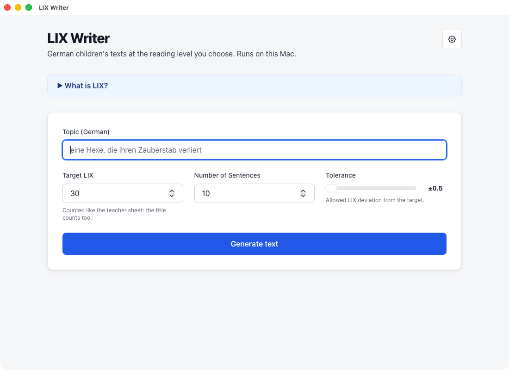
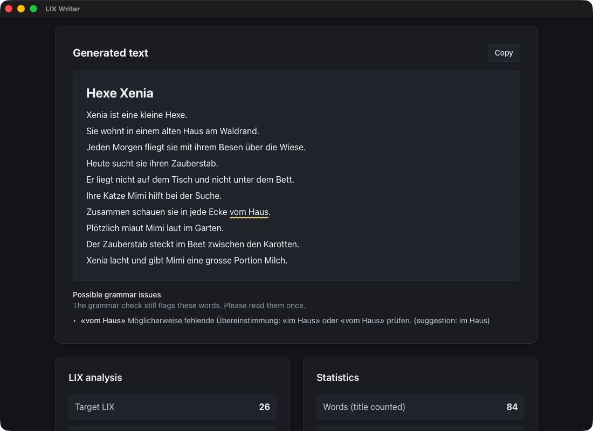
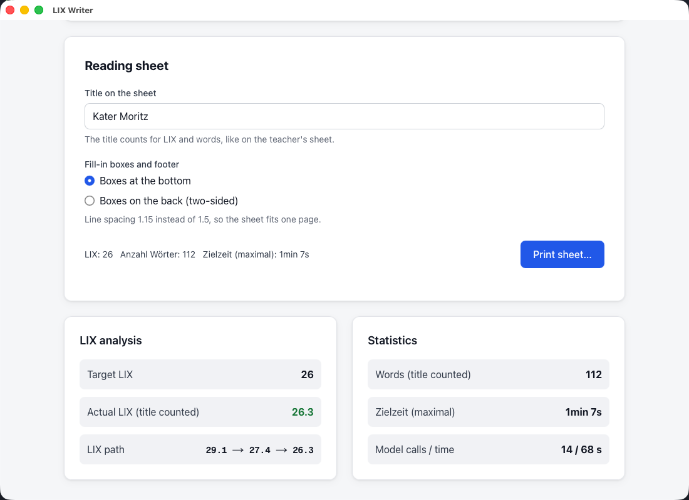
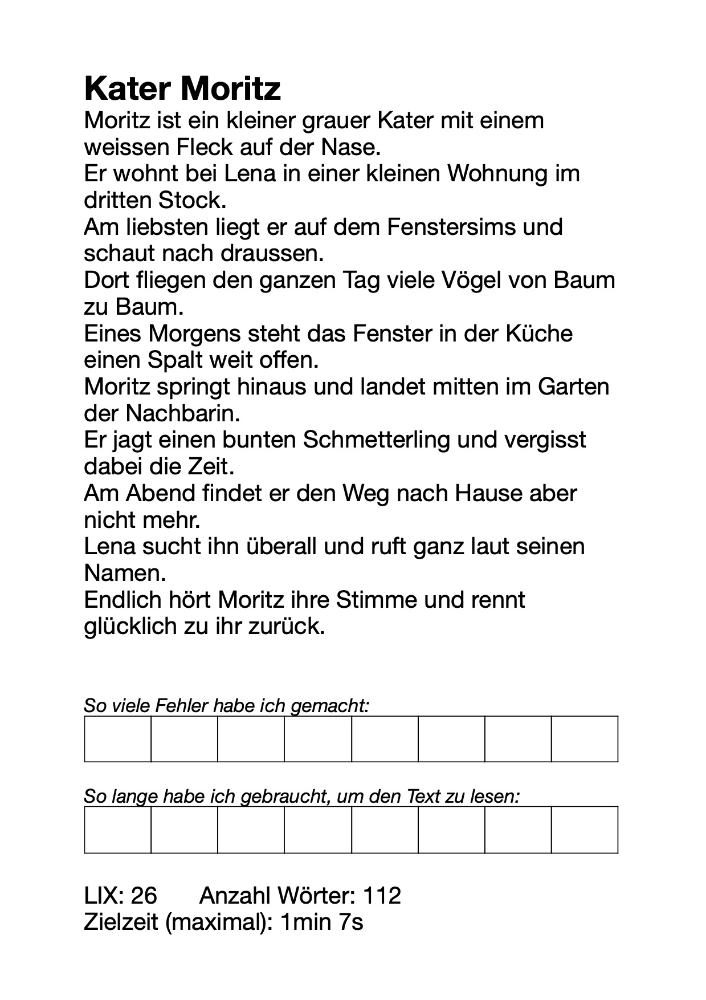

# LIX Writer

LIX Writer is a Mac app that writes short German reading texts for children at an exact LIX score. You pick a topic, a LIX value and the number of sentences. The app writes a story, then fixes it word by word until the LIX matches. You can print the text as a reading sheet.

Everything runs on your Mac. After the first setup the app works without internet.

**[Download for Mac](https://github.com/rotwurstesser/lix-tool/releases/latest)** (Apple chip, macOS 14+) · **[Handbuch auf Deutsch](HANDBUCH.md)**

<p>
  
  
</p>
<p>
  
  
</p>

LIX (Läsbarhetsindex) = words per sentence + percentage of long words (more than 6 letters). Below 30 is very easy, 30 to 40 is easy, 40 to 50 is medium.

## For teachers

### What you need

- A Mac with an Apple chip (M1 or newer) and macOS 14 (Sonoma) or newer.
- About 5 GB of free disk space (6 GB if you add the grammar check).
- Internet once, for the first setup.

### Install

1. Download `LIX.Writer_0.1.0_aarch64.dmg` from the [latest release](https://github.com/rotwurstesser/lix-tool/releases/latest).
2. Double-click it. A window opens.
3. Drag **LIX Writer** onto the **Applications** folder.
4. Open **LIX Writer** from your Applications folder.

The first time, macOS says it can not check the app ("LIX Writer Not Opened. Apple could not verify..."). This is normal: the app is not from the App Store and is not signed by Apple. To open it anyway:

1. Click **Done** in the message.
2. Open **System Settings → Privacy & Security**.
3. Scroll down. Next to the message that "LIX Writer" was blocked, click **Open Anyway** and confirm with your password.

You only do this once.

### First start

The app shows a short setup:

1. **Writing model:** the app downloads its writing model (4.3 GB). This takes a few minutes. You can cancel; the download continues where it stopped.
2. **Grammar check (optional, recommended):** LanguageTool finds most of the grammar slips the model still makes. It is about 300 MB to download and 560 MB on disk. You can add or remove it later in the settings.

After that the app is ready, also without internet.

### Writing a text

Enter a topic, the LIX value and the number of sentences, then click **Generate text**. A text takes about 15 seconds on a fast Mac, longer on smaller ones. If the app can not reach the exact LIX, it shows the closest text and its real LIX. It never hides a miss.

You can change the title before printing. LIX and word count follow the change.

### Reading sheet

**Print sheet…** opens the normal macOS print dialog. Print it, or save it as a PDF. The sheet is A4 with one sentence per line, boxes for the child to fill in, and a footer with LIX, word count and target reading time. The boxes can go at the bottom or on the back (two-sided print). When a text is too long for one page, the boxes move to the back by themselves. The sheet uses Swiss spelling (ss, no ß) and the font "Deutschschweizer Basisschrift" when it is installed.

### Settings

- **Theme:** System, Light or Dark.
- **Memory:** the writing model uses about 4 GB of RAM while it is loaded. The app frees it when idle: immediately, after 5 minutes (default) or after 15 minutes. The grammar check stops after the same time. When you quit the app, everything is freed.
- **Grammar:** turn LanguageTool on or off, add or remove it.
- **Storage:** see how much disk space the model and LanguageTool use; download the model again if it breaks.

### Privacy

Your texts never leave your Mac. The app starts its own copy of [Ollama](https://ollama.com) on your Mac, only reachable from your Mac, with cloud models turned off (`OLLAMA_NO_CLOUD`). LanguageTool also runs on your Mac. The app needs internet only for the downloads in the setup.

### Remove the app

Drag **LIX Writer** from Applications to the Trash. To also delete the model and settings, delete the folder `~/Library/Application Support/ch.rotwurstesser.lixwriter`.

## For developers

Tauri 2 app (Rust) with a Next.js UI as a static export. The generation loop is TypeScript (`lib/generate`). The app bundles the Ollama release binary and runs it on a private port with its models in the app data folder. LanguageTool (and a Java runtime) is downloaded on demand and checked with sha256.

### Toolchain

- Xcode Command Line Tools: `xcode-select --install`
- Rust via [rustup](https://rustup.rs)
- Node.js 22.18 or newer (the evals run `.ts` files directly with Node)

### Build and run

```bash
npm ci
npm run fetch-ollama   # puts Ollama 0.40.0 into src-tauri/resources/ollama (sha256 checked)
npm run tauri dev      # dev app with hot reload
npm run tauri build    # release .app and .dmg in src-tauri/target/release/bundle/
```

`npm run tauri dev` and `npm run tauri build` run `fetch-ollama` themselves too. The build is ad-hoc signed (`signingIdentity: "-"`), not notarized, so macOS asks for "Open Anyway" on other Macs (see Install above).

Dev tip (debug builds only): `LIX_APP_DATA=<dir> npm run tauri dev` keeps the model and settings in `<dir>` instead of `~/Library/Application Support/ch.rotwurstesser.lixwriter`.

### Tests

```bash
npx tsc --noEmit
npm run lint
npm test                      # vitest
cd src-tauri && cargo test
```

Live checks without the GUI: `experiments/eval/app-backend.sh` (bundled Ollama: start, pull, idle unload, port taken) and `cargo run --example grammar_cli -- --app-data <dir>` (LanguageTool: install, check, stop). Both explain their options at the top of the file.

### Evals

`experiments/eval/run.ts` runs the same generation loop headless over a fixed topic set and writes `results.jsonl` and `SUMMARY.md`. It needs a running Ollama with the model and a LanguageTool server as the judge (default `http://127.0.0.1:8081`). Example:

```bash
node experiments/eval/run.ts --set heldout --repeats 2 --targets 25,35,45 --sentences 10 \
  --ollama http://127.0.0.1:11435 --model gemma4:e2b-it-qat \
  --grammar languagetool --lt http://127.0.0.1:8081 --out experiments/runs/my-run
```

Latest results (gemma4:e2b-it-qat, M3 Ultra; gate: hit ≥ 90% within ±0.5 LIX and ≤ 10% texts with grammar findings):

| Run | Hit rate | Mean abs error | Grammar findings | Median time | Gate |
|---|---|---|---|---|---|
| held-out, model checks its own grammar | 56/60 | 0.30 | 5/60 | 14 s | PASS |
| held-out, LanguageTool in the loop | 58/60 | 0.22 | 3/60 | 13 s | PASS |

Details: `experiments/runs/*/SUMMARY.md` and `REVIVAL-NOTES.md`.

## License

MIT, see [LICENSE](LICENSE).
